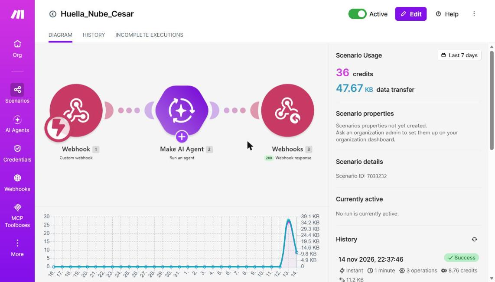
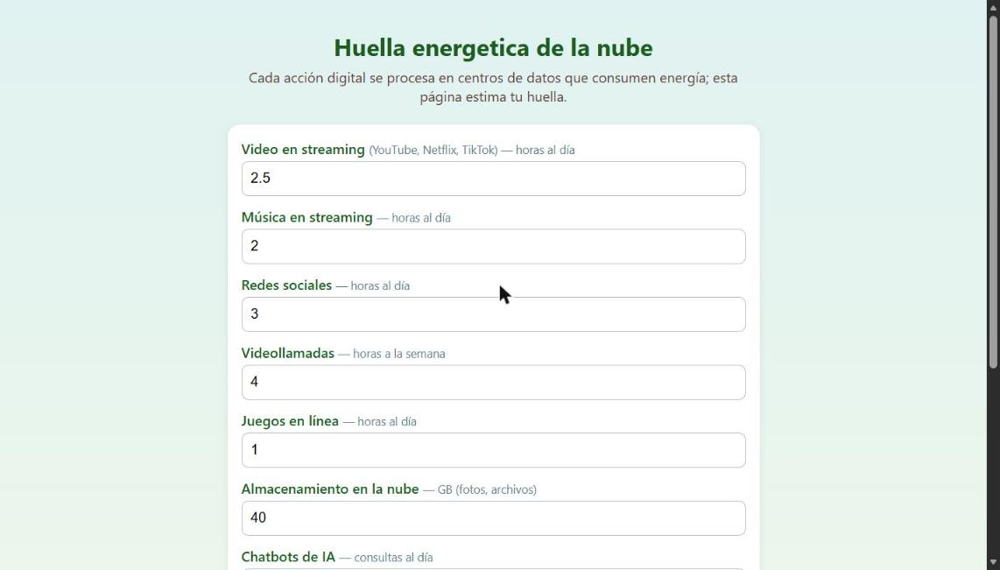
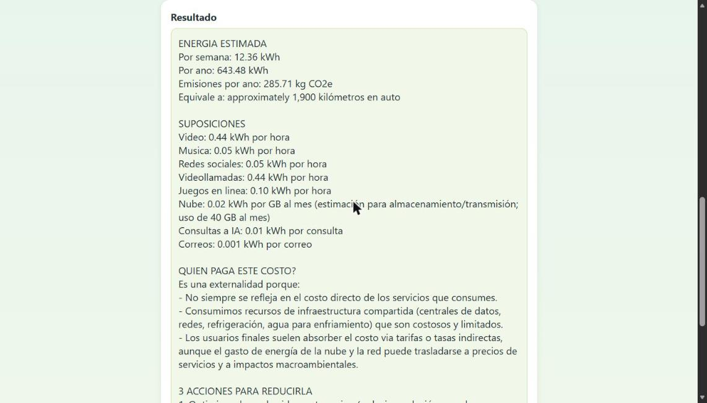

# Práctica 4.3 — Huella energética de la nube

- **Alumno:** Cesar Jesus Gamez Mendoza
- **Materia:** Desarrollo Sustentable (ACD-0908)
- **Profesor:** Mtro. Miguel Ángel Barrón Hernández
- **Institución:** Tecnológico Nacional de México — Campus Mazatlán

> **AVISO — DATOS ESTIMADOS CON IA.** No medí mi uso en Bienestar digital / Tiempo en pantalla, así que los 8 datos que capturé en la página son **estimados y generados con ayuda de IA** (valores típicos de un estudiante universitario), no mediciones reales. La página, el escenario de Make y el agente de IA son reales y funcionaron con esos datos; los resultados no describen mi huella digital real.

## Descripción
Página web donde cada persona captura su uso digital (video, música, redes, videollamadas, juegos, nube, IA y correos). La página envía los datos a un webhook de Make, un agente de IA estima la energía y las emisiones que provoca ese uso, explica quién paga ese costo (externalidad) y propone 3 acciones para reducirlo. El resultado se muestra en la misma página.

**Flujo:** Página web → Webhook de Make → Make AI Agent → Webhook Response → Página web.

## Objetivo
Reconocer el consumo energético de los servicios digitales como un costo externalizado, estimar la huella digital propia con apoyo de IA y evaluar críticamente sus suposiciones.

## Material utilizado
- Computadora con navegador y celular (tiempo de pantalla)
- Cuenta de Make (conexión *Make's AI Provider*)
- Repositorio de GitHub con GitHub Pages

## Página publicada
https://cesargm-max.github.io/Huella-energetica-de-la-nube/Codigo/

## Código
- [`Codigo/blueprint.json`](Codigo/blueprint.json): escenario de Make exportado (importable con *Import Blueprint*).
- [`Codigo/Explicacion del blueprint.md`](Codigo/Explicacion%20del%20blueprint.md): explicación módulo por módulo.
- [`Codigo/index.html`](Codigo/index.html): página web de la práctica.

## Imágenes
Escenario de Make completo, con los 3 módulos (Webhook → Make AI Agent → Webhook Response):



Página con los datos estimados capturados:



Resultado devuelto por el agente de IA:



## Video
[`Video/enlace.txt`](Video/enlace.txt)

## Resultados
[`Resultados/Resultados.pdf`](Resultados/Resultados.pdf)

## Datos capturados y reporte de la IA (datos estimados con IA)
| Actividad | Dato capturado |
|---|---|
| Video en streaming | 2.5 h/día |
| Música en streaming | 2 h/día |
| Redes sociales | 3 h/día |
| Videollamadas | 4 h/semana |
| Juegos en línea | 1 h/día |
| Nube | 40 GB |
| Chatbots de IA | 15 consultas/día |
| Correos | 10 al día |

Reporte del agente (tal cual):

```
ENERGIA ESTIMADA
Por semana: 12.36 kWh
Por ano: 643.48 kWh
Emisiones por ano: 285.71 kg CO2e
Equivale a: approximately 1,900 kilómetros en auto

SUPOSICIONES
Video: 0.44 kWh por hora
Musica: 0.05 kWh por hora
Redes sociales: 0.05 kWh por hora
Videollamadas: 0.44 kWh por hora
Juegos en linea: 0.10 kWh por hora
Nube: 0.02 kWh por GB al mes (estimación para almacenamiento/transmisión; uso de 40 GB al mes)
Consultas a IA: 0.01 kWh por consulta
Correos: 0.001 kWh por correo

QUIEN PAGA ESTE COSTO?
Es una externalidad porque:
- No siempre se refleja en el costo directo de los servicios que consumes.
- Consumimos recursos de infraestructura compartida (centrales de datos, redes, refrigeración, agua para enfriamiento) que son costosos y limitados.
- Los usuarios finales suelen absorber el costo via tarifas o tasas indirectas, aunque el gasto de energía de la nube y la red puede trasladarse a precios de servicios y a impactos macroambientales.

3 ACCIONES PARA REDUCIRLA
1. Optimizar el uso de video y streaming (reducir resolución cuando no se necesita o limitar horarios de alto consumo).
2. Priorizar herramientas de bajo consumo para videollamadas y mensajería, y reducir uso innecesario de redes sociales en horas pico.
3. Almacenar datos en la nube de manera eficiente (eliminar duplicados, usar formatos comprimidos y realizar limpieza periódica).
```

## Verificación
- **Suposición de video:** la IA usó **0.44 kWh/h**; las fuentes dan 0.077 (IEA) y 0.8 (Shift Project), así que **sí está dentro del rango**.
- **Suma de la IA:** con las suposiciones que ella misma declaró sumé a mano 13.21 kWh/semana (video 7.70, videollamadas 1.76, redes 1.05, IA 1.05, música 0.70, juegos 0.70, nube 0.18, correos 0.07), unos **689 kWh/año y 306 kg CO2e**. La IA reportó 12.36 kWh/semana y 643.48 kWh/año, alrededor de **6.6% menos**. Sus emisiones sí concuerdan con su energía (643.48 × 0.444 = 285.7 kg). También escribió que usé 40 GB "al mes" cuando capturé 40 GB almacenados. Conclusión: sirve como orden de magnitud, pero hay que revisar sus cuentas.
- **Actividad que más consume:** el video en streaming (~58% de la energía).

## Conclusiones
Ver la conclusión y las respuestas a las 5 preguntas en [`Resultados/Resultados.pdf`](Resultados/Resultados.pdf).

Factor de emisión usado: 0.444 kg CO2e/kWh (Sistema Eléctrico Nacional 2024, SEMARNAT). Energía de streaming: IEA 0.077 kWh/h vs. Shift Project 0.8 kWh/h.
